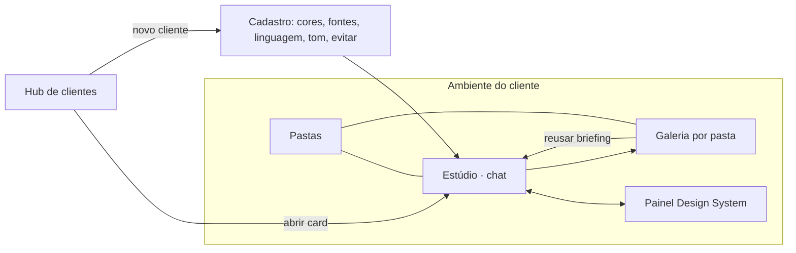
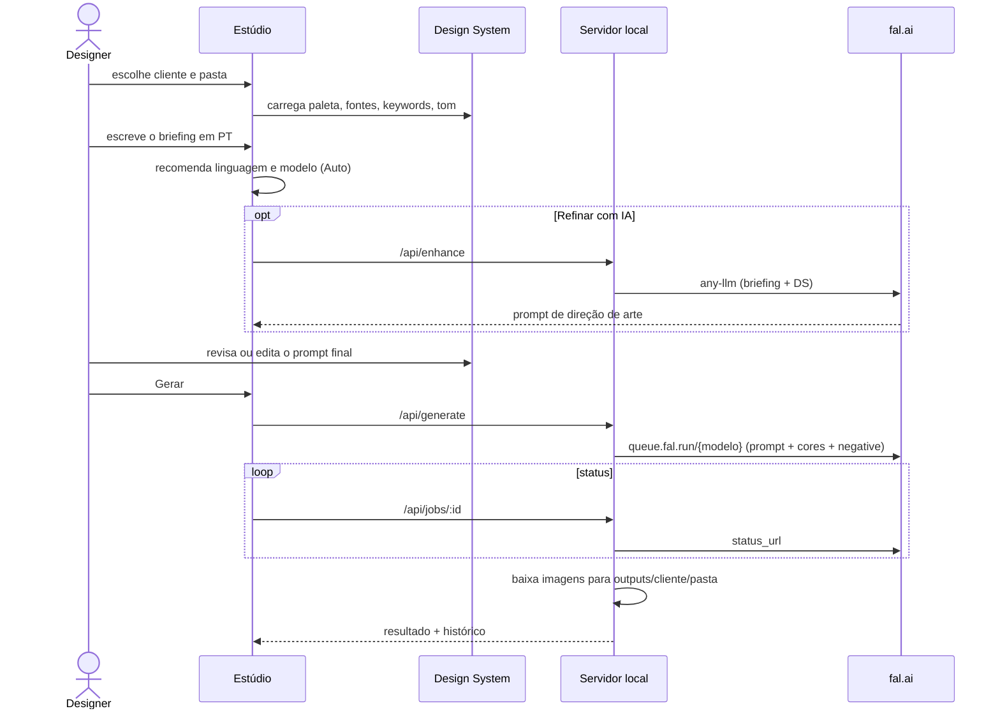

# Mapa de UX · Creative Hub

## Ideia central

O chat não fica solto: **ele sempre acontece dentro do ambiente de um cliente.**
Tudo que a IA gera herda o contexto (design system, pasta, histórico), e tudo que a IA usa fica visível e editável.
A referência visual (Echo AI) dá a base: sidebar com navegação e histórico, hero de boas-vindas,
cards de sugestão e um compositor com seletor de modelo. Aqui cada uma dessas peças passa a ser do cliente.

| Peça da referência | No Creative Hub |
| --- | --- |
| Histórico Pinned / Today | Clientes → pastas do cliente ativo (com contagem de criações) |
| "Welcome to Echo AI" + orb | Monograma do cliente com o brilho nas **cores da marca**. O tema do app muda com o cliente |
| Cards de sugestão | Sugestões de briefing cadastradas por cliente |
| Seletor "3.5 Sonnet" | Seletor de modelo com **Auto (recomendado)** e o motivo da escolha |
| Ícones chat / imagem / música | Linguagem visual: Foto · Ilustração · Vetor · 3D · Tipografia |
| Card "Upgrade to Pro" | Status da conexão com a fal.ai |

## Arquitetura de informação

## Jornada principal

## Camadas de contexto (como IA e cliente conversam)

1. **Cliente**: define o tema da interface (glow, orb, botão de enviar) com as cores da marca. Você sempre sabe "onde está".
2. **Pasta**: destino da entrega, mostrado como chip no compositor e trocável no breadcrumb.
3. **Design system**: injetado no prompt. Cada keyword pode ser desligada. A paleta vira parâmetro real nos modelos que aceitam.
4. **Linguagem visual + modelo**: o modo Auto explica a escolha ("Pedido com texto na imagem → Ideogram").
5. **Prompt final**: transparência total. É o texto exato enviado, editável antes de gerar.
6. **Resultado**: cada geração guarda briefing, prompt final, modelo, seed e pasta. Dá para gerar de novo, editar ou reusar a partir da galeria.

## Estados de cada geração

`Na fila (posição N)` → `Gerando…` (skeleton no formato escolhido) → `Salvo em <pasta>` · ou `Falhou` com o motivo
(ex.: saldo esgotado, chave inválida) e o botão "Gerar de novo".

## Próximas etapas sugeridas

- **Referências do cliente**: upload de logo e fotos de produto (fal storage) e geração image-to-image / edição (ex.: `fal-ai/nano-banana/edit`).
- **Aprovação**: status por imagem (rascunho → aprovado → entregue) e link de revisão para o cliente.
- **Multiusuário**: mover `clients.json` e `history.json` para um banco (ex.: Supabase) com login da equipe.
- **Formatos de entrega**: presets por canal (Feed 4:5, Story 9:16, LinkedIn 1.91:1) e upscale antes de exportar.
- **Custo**: estimativa por geração e consumo por cliente no hub.
